# TraceForge

**Digital Forensics & Threat Investigation Platform**

[](https://github.com/ahmedhany-cys/traceforge-digital-forensics/actions/workflows/ci.yml)
   

TraceForge is a web platform for collecting, analysing, correlating, preserving and reporting digital-forensic evidence from a suspected security incident. It parses real artifact formats – Windows EVTX logs, Chromium browser history, CSV/JSON/text security logs and Windows PE executables – builds a cross-source UTC timeline, links events into explainable sequences, extracts indicators of compromise, keeps a hash-chained chain-of-custody ledger and produces reproducible PDF/JSON reports.

> **All demonstration data is simulated.** The included Meridian Financial Services case is generated by [`dataset/generator`](dataset/generator). People, hosts, IPs (RFC 5737 documentation ranges) and domains (`.example`) are fictional, and the sample executables are inert. TraceForge never executes uploaded files.

---

## Contents

- [The problem](#the-problem) · [The scenario](#the-scenario) · [Capabilities](#capabilities) · [Architecture](#architecture)
- [Detection methodology](#detection-methodology) · [Evidence integrity](#evidence-integrity) · [Screenshots](#screenshots)
- [Quick start](#quick-start) · [Usage](#usage) · [Testing](#testing) · [Security](#security) · [Limitations](#limitations)

## The problem

During an incident an investigator has to answer, from scattered artifacts:

1. What happened, and when?
2. Which files and systems were affected?
3. Was suspicious software involved?
4. What indicators of compromise exist?
5. Was sensitive information accessed or transferred?
6. Has the evidence remained unchanged?
7. Can the findings be reproduced and audited?

The answers live in different formats, clocks and timezones. TraceForge ingests them into one case, keeps every derived statement traceable to a specific record in a specific, hash-verified evidence file, and is explicit about what the evidence does **not** prove.

## The scenario

**Meridian Financial Services** (fictional) receives an alert about finance workstation `WS-FIN-042`. The synthetic evidence set contains:

| Evidence | Format | What it records |
|---|---|---|
| `WS-FIN-042_Security.evtx` | EVTX | Logons, failed logons, process creation (with command lines), object access to confidential files, scheduled task, account creation, admin-group change, WFP connections |
| `WS-FIN-042_System.evtx` | EVTX | Service installation, service state, *Windows PowerShell* log cleared |
| `WS-FIN-042_PowerShell-Operational.evtx` | EVTX | Script blocks: staging, archiving, upload, log clearing |
| `Chrome_History_jmorales.sqlite` | SQLite | Webmail visit and download of `Q3_Vendor_Invoice.pdf.exe` (browser warned, user kept it) |
| `fw-edge-01_connections.csv` | CSV | Beacons and a 48 MB outbound transfer to 203.0.113.77 |
| `resolver_queries.log` | Text (local time) | DNS lookups of the lure and C2 domains, plus a truncated line |
| `edr_file_events.json` | JSON (local time) | File writes with SHA-256, confidential-file reads, archive create/delete |
| `Q3_Vendor_Invoice.pdf.exe` | PE32+ | Inert sample with injection/network/persistence imports, a W+X high-entropy section, C2 strings |
| `MFS_ReportViewer.exe` | PE32+ | Known-good control sample |

The generator writes **real binary formats** (it includes a standards-based EVTX writer with valid chunk/file CRC32s and a PE builder) and is deterministic – regenerating produces byte-identical files whose hashes match [`manifest.json`](dataset/meridian/manifest.json). The ground-truth story is in [`SCENARIO.md`](dataset/meridian/SCENARIO.md).

## Capabilities

| Module | Implementation highlights |
|---|---|
| **Evidence acquisition** | Multi-file upload; streaming SHA-256/SHA-1/MD5; content-based type detection with extension consistency checks; size limits at the ASGI layer and while streaming; duplicate detection by hash; random vault names; read-only vault copies; UTC acquisition records; full acquisition history |
| **Static malware analysis** | `pefile` headers, sections, imports/exports, imphash, overlay, checksum; per-section and file Shannon entropy; ASCII/UTF-16 string extraction and categorisation; suspicious-API catalogue; 16 explained indicator types (PE-000…PE-015); assessment that never says "malicious" |
| **YARA engine** | 7 original rules (using `pe` and `math` modules) with mandatory explanatory metadata; compilation/validation; scans every evidence item; match strings and offsets; validator for new rules in the UI |
| **Windows event analysis** | python-evtx parsing with header/chunk CRC checks, per-record error capture, exact FILETIME timestamps, EventData/UserData; 18 JSON-configurable rules with audit-policy prerequisites and aggregation; PowerShell `-EncodedCommand` decoding |
| **Browser forensics** | Chromium `History`: visits, typed/link transitions, downloads, URL chains, referrers, danger type, recorded hash; read-only immutable SQLite on a hash-verified private copy; schema-tolerant |
| **Timeline engine** | All sources normalised to UTC with original timestamp preserved and assumed timezones flagged; entities (host, PID, parent PID, image, file, hash, destination, bytes) extracted per event |
| **Correlation** | Sequence rules linking steps by shared file name/hash, **PID process lineage**, or destinations hard-coded in an analysed binary; confidence from link strength; explanations and caveats; stored as hypotheses |
| **IOC extraction** | IPv4, domains, URLs, SHA-256/SHA-1/MD5, suspicious filenames, process images; refanging and validation; private/documentation/reserved classification; local watchlist; conservative assessments with reasons and every occurrence |
| **Chain of custody** | Hash-chained audit ledger for acquisition, access, export, analysis, verification, reporting, logins and configuration; ledger verification that localises tampering; integrity-check history |
| **Reporting** | PDF (ReportLab) and JSON; reproducible `content_sha256`; confirmed vs suspicious vs hypothesis sections; limitations; ledger head hash |
| **Dashboard** | React + TypeScript + Tailwind + Recharts; 11 sections wired to the API; role-aware actions |
| **Security** | Argon2id, server-side sessions, CSRF tokens, RBAC, lockout, CSP and security headers, generic errors, bandit + pip-audit + npm audit |

## Architecture

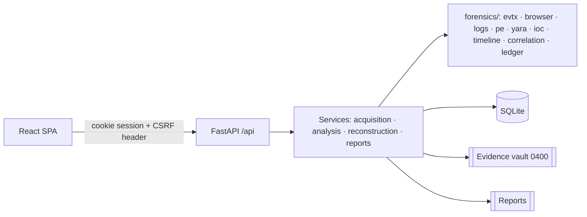

The `forensics/` package is pure Python with no web or database imports; services persist its output; the API is a thin layer. Details, data model and design decisions: [docs/ARCHITECTURE.md](docs/ARCHITECTURE.md).

## Detection methodology

Outputs are kept in separate, explicit classes: **confirmed rule match** (a rule's condition is provably met), **suspicious** (consistent with malicious activity, benign explanations stated), **informational**, **inconclusive** (damaged/unparseable input) and **hypothesis** (correlated sequence). Every finding has a rule ID, severity, confidence, description and rationale; Windows rules state the audit policy they depend on.

In the Meridian case the engine reconstructs the chain *download → file written (same SHA-256) → execution → confidential-file access by a process in the sample's PID lineage → 48 MB transfer to an IP hard-coded in the sample* with **high** confidence, while reporting *archive → transfer* as **low** confidence because only host and time connect those two events. The unrelated failed logons from another host are flagged but never pulled into a sequence.

Full rule catalogue: [docs/DETECTION_RULES.md](docs/DETECTION_RULES.md).

## Evidence integrity

* SHA-256 computed while streaming; the stored copy is re-hashed before it is accepted.
* Vault files are read-only, randomly named and never served statically.
* Integrity is re-verified before and after every analysis run (analysis refuses mismatched evidence), on demand, and whenever a report is generated; every check is recorded.
* Every action is appended to a **hash-chained ledger** (`record_hash = SHA-256(canonical record ‖ prev_hash)`); verification detects modified, deleted, inserted or re-ordered records and reports the first broken link.
* The ledger is **tamper-evident, not immutable**: someone with database write access could rebuild the whole chain. Recording the head hash outside the system (it is printed in every report) closes that gap. See [docs/LIMITATIONS.md](docs/LIMITATIONS.md#tamper-evident-vs-immutable).

TraceForge does not claim legal admissibility or compliance with any chain-of-custody standard.

## Screenshots

All screenshots were captured from the running application (backend serving the production build) with the synthetic case loaded, using [`scripts/screenshots/capture.mjs`](scripts/screenshots/capture.mjs) driving a local Chrome. The report image is rendered from the generated PDF by [`render_pdf.py`](scripts/screenshots/render_pdf.py).

### Overview – metrics computed from the case database
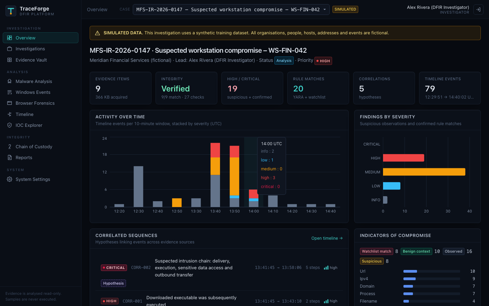

### Investigation details and analyst conclusions
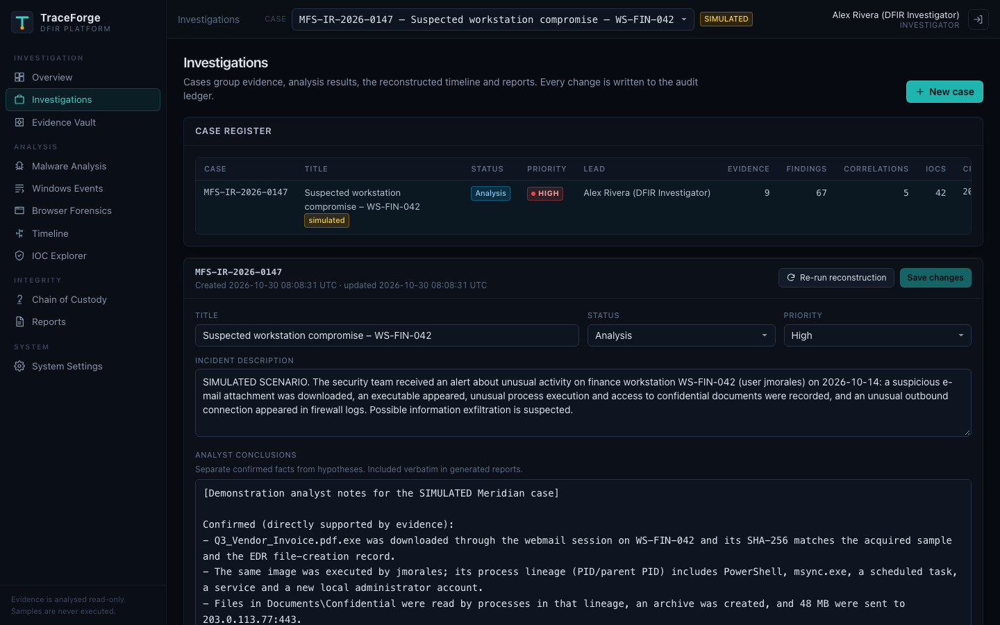

### Evidence acquisition – content-based validation rejecting a duplicate and a disguised file
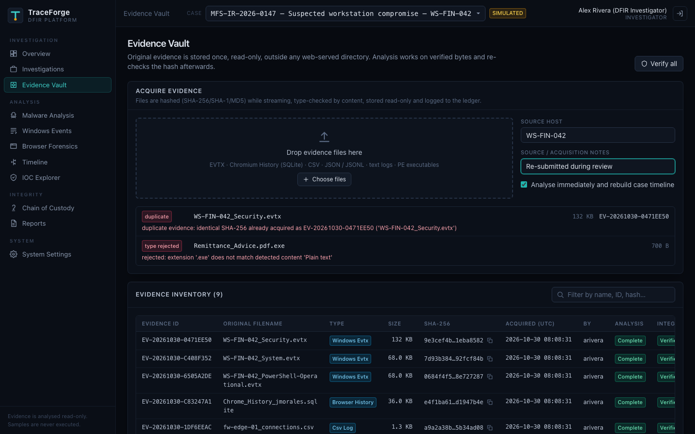

### Evidence inventory
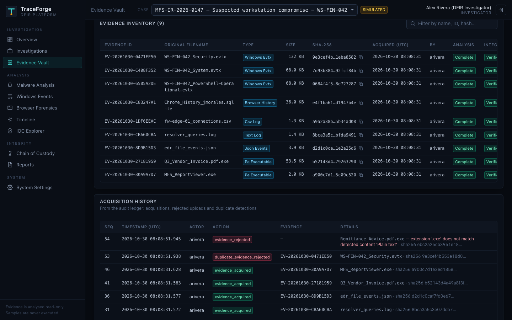

### Malware static analysis
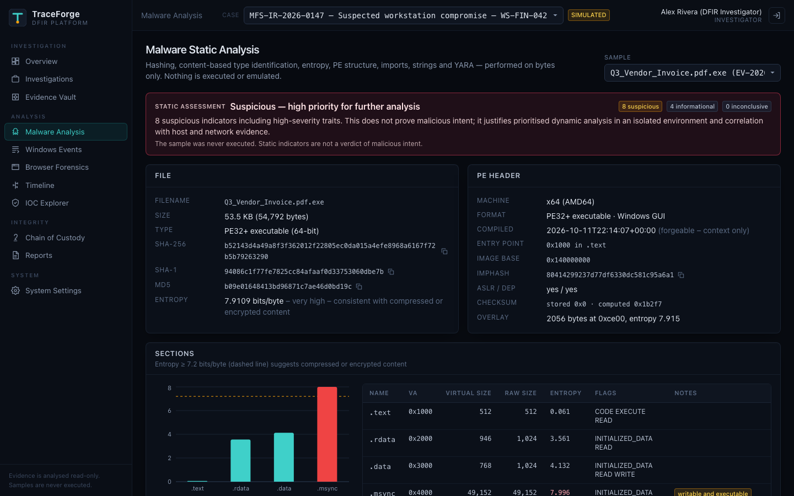
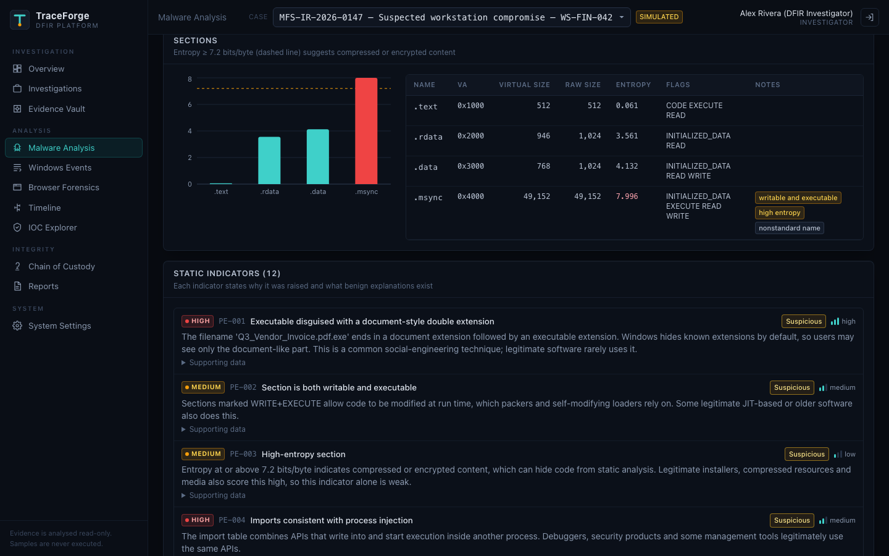

### YARA scan results
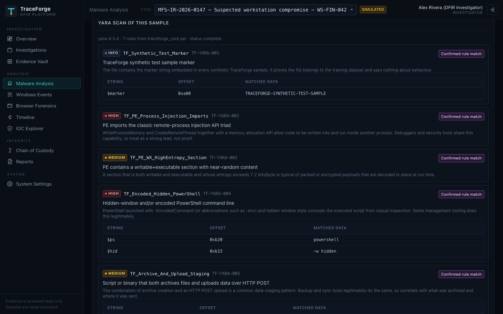

### Windows event analysis (decoded detections and full EventData)
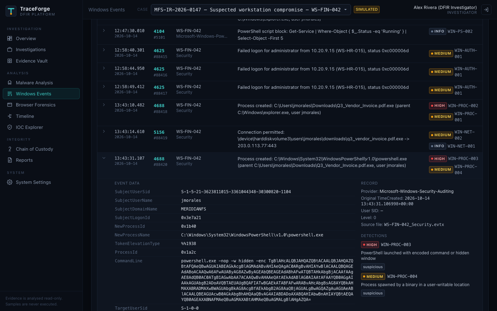

### Browser forensics
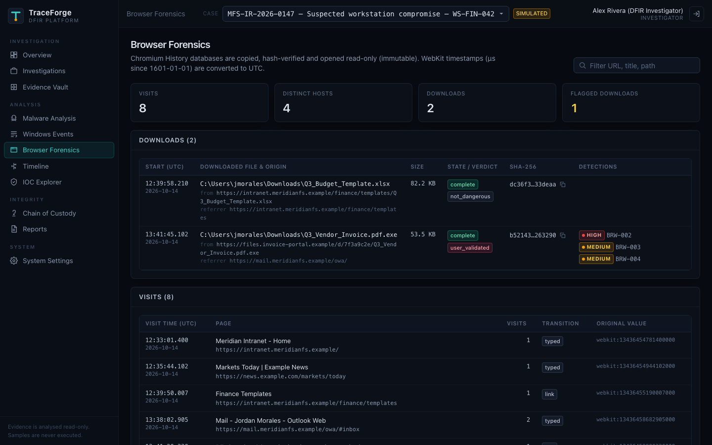

### Investigation timeline and correlated sequences
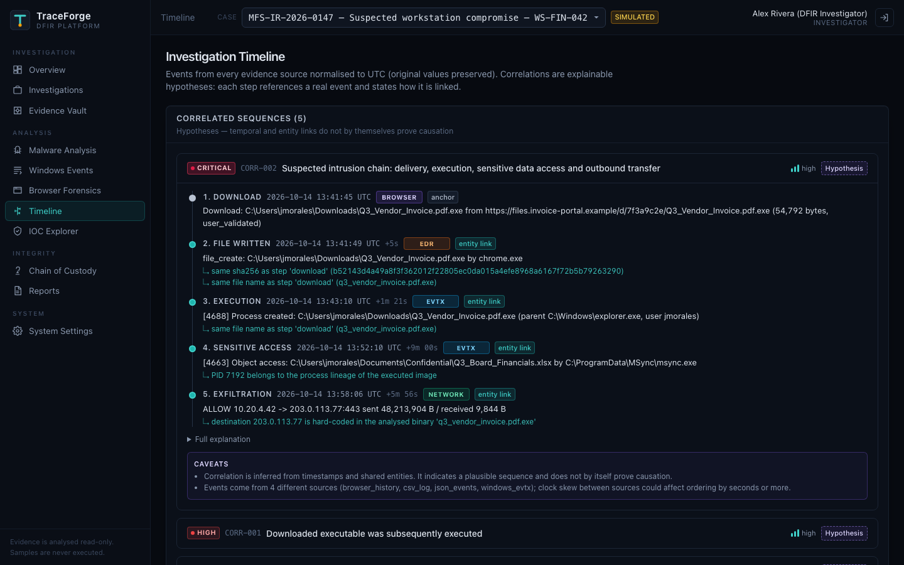
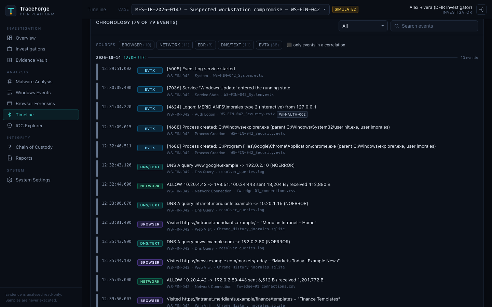

### IOC explorer
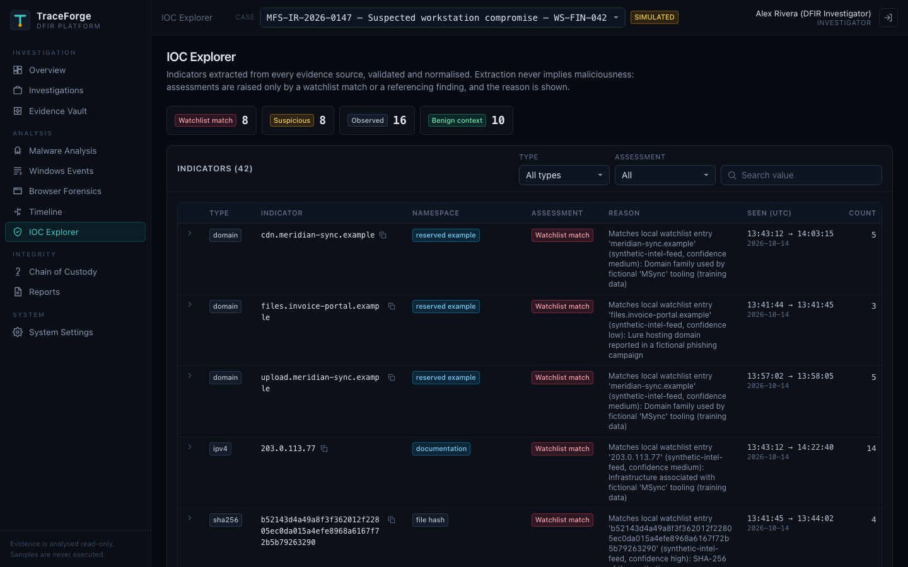

### Chain of custody – hash-chained ledger verification
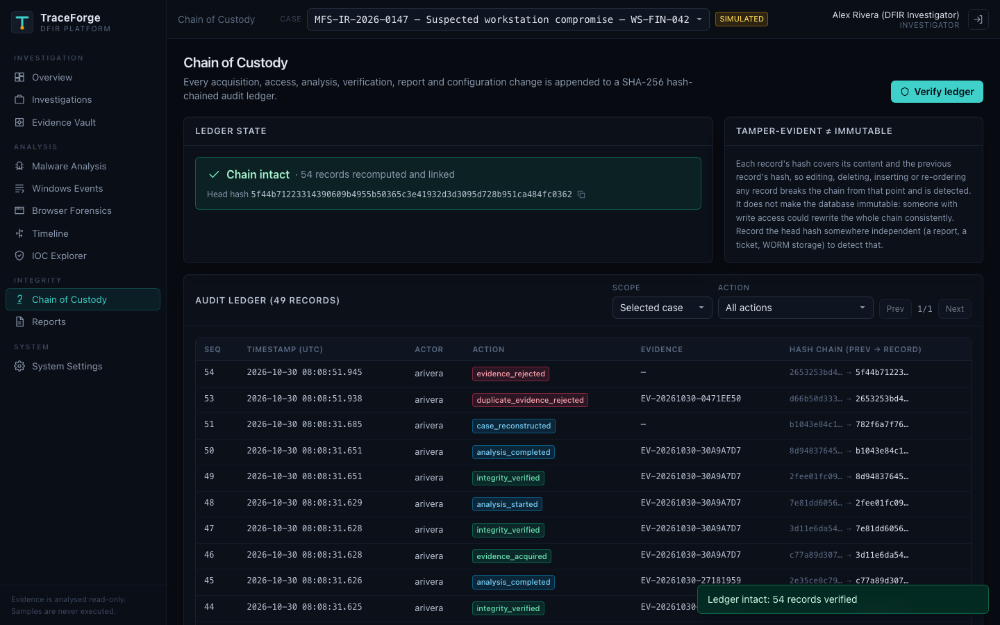

### Evidence integrity verification history
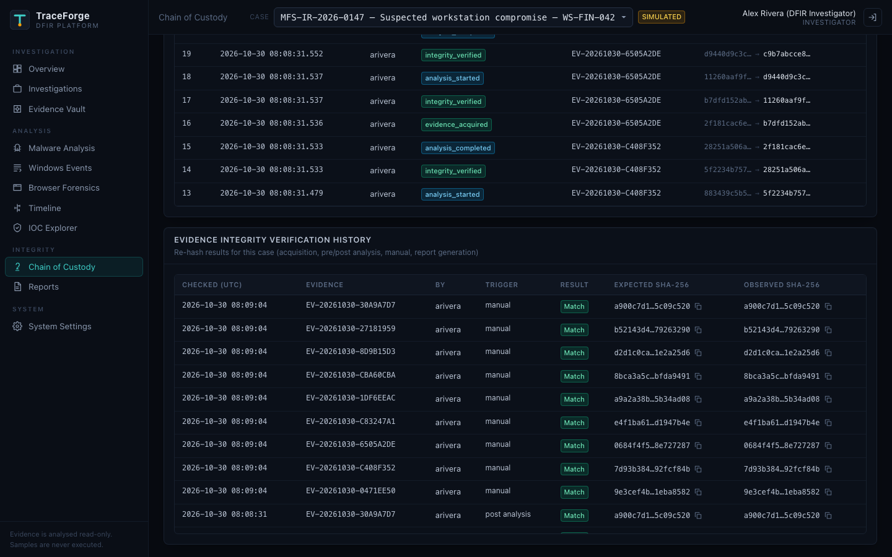

### Generated PDF report (rendered pages of the real output)
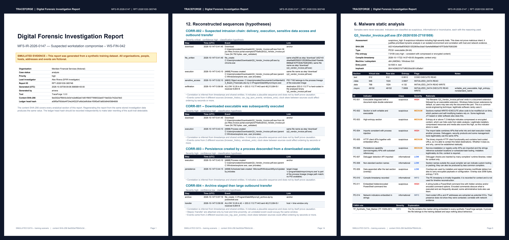

### Reports page
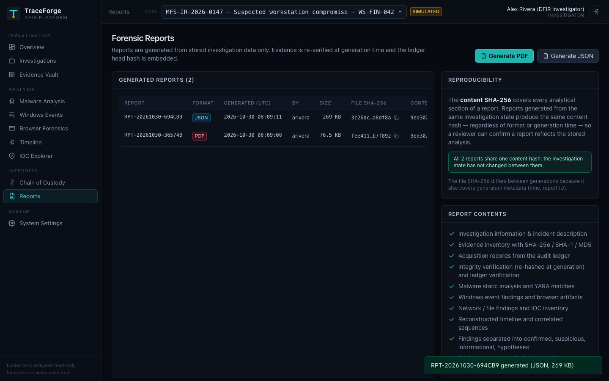

A sample report generated from the demo case is in [`docs/sample-reports/`](docs/sample-reports).

## Quick start

```bash
git clone https://github.com/ahmedhany-cys/traceforge-digital-forensics.git
cd traceforge-digital-forensics
python3.12 -m venv .venv && .venv/bin/pip install -r backend/requirements-dev.txt

cd backend
../.venv/bin/python -m app.cli load-demo          # ingests the synthetic case through the real pipeline
cat data/demo-credentials.txt                     # randomly generated demo passwords (git-ignored)
../.venv/bin/python -m uvicorn app.main:get_app --factory --port 8000
```

```bash
cd frontend && npm ci && npm run dev              # http://127.0.0.1:5173
```

Docker Compose and configuration options: [docs/INSTALLATION.md](docs/INSTALLATION.md).

## Usage

1. Sign in as `arivera` (investigator). The **Overview** shows the Meridian case.
2. **Evidence Vault** – upload new artifacts (try a duplicate or a renamed text file to see validation), verify integrity, export a copy.
3. **Malware Analysis / Windows Events / Browser Forensics** – review parsed data and explained findings.
4. **Timeline** – filter the cross-source timeline; open a correlation to see each step's link reasons and caveats.
5. **IOC Explorer** – indicators with namespace classification, assessment reason and occurrences; import a CSV watchlist.
6. **Chain of Custody** – inspect and verify the ledger.
7. **Reports** – generate PDF/JSON; regenerate and compare `content_sha256`.

Step-by-step walkthrough of the case: [docs/FORENSIC_WORKFLOW.md](docs/FORENSIC_WORKFLOW.md).

## Testing

```bash
cd backend && ../.venv/bin/python -m pytest       # 97 tests, 89% coverage
cd frontend && npm test                           # 18 tests
```

The backend suite exercises real parsing of the dataset files and malformed inputs (corrupted EVTX chunks, truncated PEs, malformed SQLite, bad log lines), tamper detection for evidence and ledger, correlation correctness (including negative cases), reproducible reports, authentication/authorisation/CSRF, upload validation and API error handling. `bandit` reports 0 issues; `pip-audit` and `npm audit` report no known vulnerabilities. Results: [docs/TESTING.md](docs/TESTING.md).

## Security

TraceForge treats itself as security-sensitive software: uploads are never executed, types are verified from content, the vault is private, all SQL is parameterised, sessions are server-side with CSRF protection, roles are enforced server-side, and responses carry a strict CSP. See [SECURITY.md](SECURITY.md) and the [threat model](docs/THREAT_MODEL.md).

## Limitations

Static analysis only; Chromium-only browser support; logical artifacts only (no disk/memory images); SQLite single node; synchronous analysis; no MFA; tamper-evident (not immutable) ledger; correlations are hypotheses; not a validated or court-certified tool. Full list: [docs/LIMITATIONS.md](docs/LIMITATIONS.md).

## Project structure

```
backend/   FastAPI app, forensic engine, rules, tests
frontend/  React + TypeScript dashboard
dataset/   synthetic evidence generator and the generated Meridian case
docs/      architecture, threat model, workflow, rules, testing, limitations, sample reports
scripts/   screenshot capture tooling
```

## License

[MIT](LICENSE)
