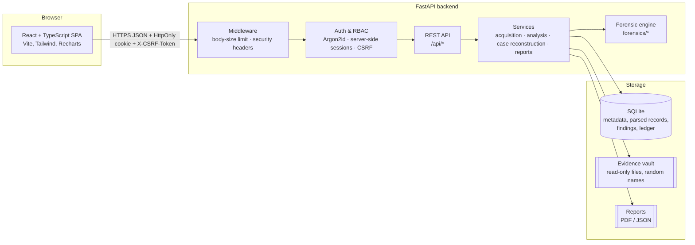
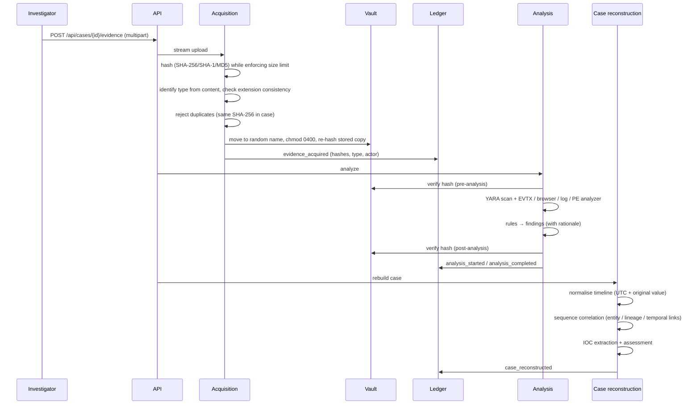

# Architecture

TraceForge is a single-tenant web application: a Python/FastAPI backend that owns all forensic processing and state, and a React single-page app that renders it. SQLite stores metadata and derived results; evidence files live in a private vault directory on disk.



## Backend layout

```
backend/
  app/
    main.py              application factory, error handlers, SPA hosting
    config.py            settings (env vars TRACEFORGE_*)
    database.py          SQLAlchemy engine/session (per-app session factory)
    models.py            ORM models
    cli.py               init-db, create-user, load-demo, verify-ledger
    core/
      security.py        Argon2id hashing, sessions, CSRF, role checks, login throttling
      middleware.py      request body limits, security headers
    api/                 thin HTTP layer (auth, cases, evidence, custody, admin) + serializers
    services/            orchestration that touches the database
      acquisition.py     streaming upload → validation → vault → ledger
      integrity.py       re-hash and compare with acquisition hash
      analysis.py        per-evidence pipeline (YARA + type-specific analyzer + findings)
      case_analysis.py   timeline, correlation and IOC reconstruction for a case
      reports.py         report generation and storage
      runtime_settings.py analyst-adjustable settings
    forensics/           pure, database-free forensic logic (unit-testable)
      hashing.py  filetype.py  ledger.py  timeutil.py  entropy.py  strings.py
      pe_analysis.py  yara_engine.py  evtx_parser.py  event_rules.py
      browser.py  logs.py  artifact_rules.py  ioc.py  netclass.py  correlation.py
    reporting/
      builder.py         deterministic report content + integrity snapshot
      pdf.py             ReportLab renderer
  rules/
    yara/*.yar                         original YARA rules (with required metadata)
    detections/windows_events.json     Windows event detection rules
    detections/correlation.json        sequence correlation rules
  tests/                               pytest suite
dataset/
  generator/                           EVTX writer, PE builder, scenario generator
  meridian/                            generated synthetic evidence + manifest
frontend/                              React app
```

The `forensics/` package has no dependency on the database or web framework. Services adapt it to persistence; the API adapts services to HTTP. This keeps parsers and detection logic testable in isolation and reusable from the CLI.

## Evidence processing pipeline



## Data model (main tables)

| Table | Purpose |
|---|---|
| `users`, `sessions` | Accounts (role: viewer / investigator / admin), server-side sessions (token stored as SHA-256) |
| `cases` | Investigation metadata and analyst conclusions |
| `evidence` | Acquisition record: original name, random storage name, size, SHA-256/SHA-1/MD5, detected type, acquirer, integrity status |
| `audit_ledger` | Hash-chained audit records (`prev_hash` → `record_hash`) |
| `integrity_checks` | Every re-hash of every evidence item (acquisition, pre/post analysis, manual, report) |
| `analysis_runs` | One row per analyzer execution, with engine version, summary JSON and parse errors |
| `windows_events`, `browser_artifacts`, `log_records` | Parsed records, each tied to its evidence item and analysis run |
| `findings` | Rule outputs: source, rule ID, classification, severity, confidence, description, rationale, source reference |
| `timeline_events` | Normalised, cross-source events with entities used for correlation |
| `correlations` | Sequence hypotheses: steps (each referencing a timeline event), link reasons, confidence, caveats |
| `iocs`, `watchlist` | Indicators with namespace classification, assessment and occurrences; local reference watchlist |
| `reports`, `settings` | Generated report metadata (file hash + content hash); runtime settings |

## Key design decisions

| Decision | Reason |
|---|---|
| **SQLite** | Zero-cost, file-based, adequate for a single-analyst or small-team deployment. WAL mode and a busy timeout handle concurrent readers. A server database would be needed for multi-user scale. |
| **Content-based type detection instead of `python-magic`** | libmagic is a native dependency with a history of parser vulnerabilities; the accepted formats have simple, documented signatures. See `forensics/filetype.py`. |
| **`defusedxml` for EVTX XML** | python-evtx renders binary XML to text; defusedxml parses it without entity expansion. |
| **Synchronous analysis** | Simplifies reasoning about ordering and integrity checks. Large files would justify a job queue (documented limitation). |
| **Rules as data** | Windows event and correlation rules are JSON so they can be reviewed and changed without code; YARA rules require explanatory metadata. |
| **Deterministic report content** | Reports separate deterministic content (hashed) from time-dependent metadata so the same investigation state reproduces the same `content_sha256`. |
| **Per-record EVTX templates in the dataset generator** | Simpler and auditable; still a valid EVTX encoding that python-evtx parses with CRCs verified. |
| **Session cookies + CSRF token rather than JWT** | Server-side sessions can be revoked immediately and never expose tokens to JavaScript. |
