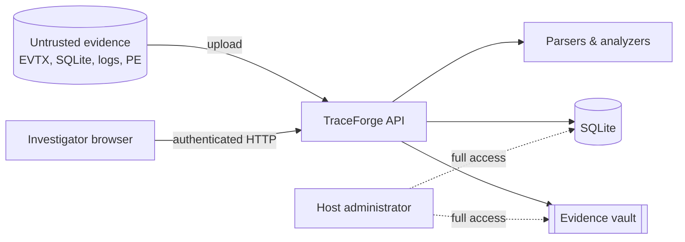

# Threat Model

TraceForge processes untrusted, potentially hostile files (suspected malware, attacker-influenced logs) and holds sensitive investigation data. This document lists what it defends against, how, and what it does not cover.

## Assets

1. **Evidence files** and their integrity (the acquisition SHA-256 must remain verifiable).
2. **Investigation data**: parsed records, findings, conclusions, reports.
3. **Audit trail**: who acquired, accessed, analysed, exported or verified what, and when.
4. **Investigator accounts and sessions.**
5. **The analysis host** that runs TraceForge.

## Trust boundaries

* Evidence content is **always untrusted** – including filenames, MIME types, strings inside logs and browser titles.
* Authenticated users are trusted according to role (viewer < investigator < admin).
* The host OS administrator is **fully trusted** (see residual risks).

## Threats and mitigations

| # | Threat | Mitigation |
|---|---|---|
| T1 | Uploaded binary gets executed | Nothing ever executes evidence. PE analysis uses `pefile` as a parser; YARA scans bytes. Vault files are stored `0400` without execute permission, under random names with no extension. |
| T2 | Type confusion (e.g. a script renamed `.log`, a PE renamed `.csv`) | Type is detected from content; the extension must be consistent; unsupported formats (ZIP, ELF, scripts, PDF...) are rejected and the rejection is ledgered. |
| T3 | Path traversal via filenames | Client filenames are sanitised for display only and never used as paths. Storage paths are `vault/case-<id>/<random hex>` and resolved paths are checked to remain inside the vault. |
| T4 | Resource exhaustion (huge uploads, zip-bomb-like inputs) | ASGI middleware rejects bodies over the limit (with or without Content-Length); uploads are streamed to disk with a running size check; parsers cap records (EVTX 500k, logs 1M, SQLite rows 200k), line length, YARA scan size (64 MiB) and YARA timeout (30 s). |
| T5 | Parser exploitation by malformed files | Mature parsers (python-evtx, sqlite3, pefile); per-record exception handling; `defusedxml` for XML; SQLite opened read-only and immutable on a private copy; `PRAGMA quick_check` first. Residual risk remains (see below). |
| T6 | SQL injection | ORM / bound parameters everywhere. The browser parser only concatenates constant SQL and allow-listed column names (verified by `bandit` with justification). Search inputs are bound `LIKE` parameters (tested). |
| T7 | XSS via evidence content (titles, URLs, script blocks) | React renders evidence strings as text; no `dangerouslySetInnerHTML`. Strict CSP (`script-src 'self'`, `object-src 'none'`, `frame-ancestors 'none'`). PDF generation XML-escapes all dynamic text. Exported evidence is served as `application/octet-stream` attachments with `nosniff` and a sandbox CSP. |
| T8 | Credential attacks | Argon2id password hashing, password policy (≥12 chars, 3 classes), per-username+IP lockout after 5 failures, generic error messages, constant-work verification for unknown users, all attempts ledgered. |
| T9 | Session theft / fixation | 256-bit random session tokens stored hashed server-side, `HttpOnly` + `SameSite=Strict` cookies (`Secure` in TLS deployments), absolute (8 h) and idle (60 min) expiry, logout deletes the session. |
| T10 | CSRF | SameSite=Strict plus a per-session synchroniser token required in `X-CSRF-Token` for every state-changing request. |
| T11 | Privilege escalation | Role checks on every mutating endpoint (`require_role`); viewers are read-only; settings/users are admin-only; admins cannot demote/disable themselves. Covered by tests. |
| T12 | Silent evidence tampering | SHA-256 at acquisition; re-verification before and after every analysis, on demand, and during report generation; analysis refuses mismatched evidence; mismatches are ledgered. |
| T13 | Audit trail tampering | Hash-chained ledger; verification localises modified, removed, inserted or re-ordered records; head hash printed in reports for external anchoring. |
| T14 | Information leakage in errors | Global exception handler returns a generic 500; validation errors return field locations only; OpenAPI docs disabled in production. |
| T15 | Evidence exposure via static hosting | Only the built SPA directory is served statically; the vault and reports directories are outside it and only reachable through authenticated, audited endpoints. |
| T16 | Vulnerable dependencies | Pinned versions; `pip-audit` and `npm audit` run as part of QA (results in `docs/TESTING.md`). |

## Residual risks (not mitigated)

* **Host compromise / malicious administrator.** Anyone with write access to the database file can rewrite the entire ledger consistently, and anyone with filesystem access can replace evidence *and* its recorded hash. Tamper-evidence only holds relative to an independently stored ledger head hash or report.
* **Parser vulnerabilities.** Native code in YARA, SQLite and Python's stdlib processes hostile input. Run TraceForge on an isolated analysis host or container (the provided compose file drops all capabilities, runs as a non-root user with a read-only root filesystem).
* **No encryption at rest.** The vault and database are plain files; use full-disk or volume encryption.
* **Single-node SQLite.** No high availability; backups are the operator's responsibility.
* **TLS** is expected to be terminated by a reverse proxy; the compose file binds to loopback only.
* **No MFA / SSO** integration.
